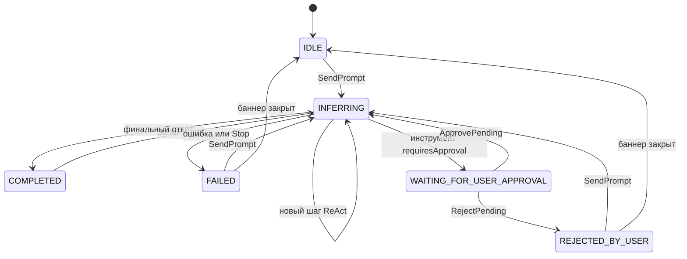

# UI/UX архитектура Meh AI

Документ описывает визуальную систему, навигацию, экраны и состояния Android-приложения автономного локального агента. Стек целевого интерфейса: Kotlin, Jetpack Compose, Material 3.

Приложение работает в двух режимах инференса. **Local** гоняет GGUF на устройстве и остаётся офлайн. **Cloud** ходит в OpenRouter. Цикл агента — ReAct: `Thought` → `Action` + `action_input` → `Observation`. Критичные инструменты останавливают цикл в состоянии `WAITING_FOR_USER_APPROVAL`, пока человек не подтвердит или не отклонит вызов.

## 1. Что уже есть в коде и что задаёт этот документ

Интерфейс агента в репозитории ещё не собран. Ниже — единственные UI-точки, на которые спецификация опирается как на существующий код. Всё остальное в документе — **рекомендуемая спецификация** для реализации: имена экранов, событий, моделей и токенов выбраны так, чтобы лечь в текущий пакет `com.meh.ai`.

| Что есть сейчас | Где | Как использует спецификация |
| --- | --- | --- |
| Точка входа, edge-to-edge, тема | `com.meh.ai.MainActivity` | `enableEdgeToEdge()` сохраняется. `Greeting` заменяется корнем `MehApp`. |
| Тема Material 3 | `com.meh.ai.ui.theme.MehAITheme` | Имя темы сохраняется. Палитра и поведение темы меняются по разделу 2. |
| Цвета шаблона | `ui/theme/Color.kt` (`Purple80`, `Purple40`, …) | Заменяются графитовыми и семантическими токенами. |
| Типографика шаблона | `ui/theme/Type.kt` — только `bodyLarge` на `FontFamily.Default` | Расширяется гротеском и `JetBrains Mono`. |
| Имя приложения | `app_name` = `Meh AI` (`strings.xml`) | Заголовок агента по умолчанию — `Meh`. |
| Зависимости UI | Compose BOM `2026.02.01`, Material 3, `minSdk` 24, `targetSdk` 36, модуль `mobile/app` | Navigation, ViewModel, Room, шрифты и QuickJS в графе зависимостей пока отсутствуют — их подключение указано в разделе 8. |

`Theme.kt` сейчас включает `dynamicColor = true` и следует системной светлой/тёмной теме. Продуктовая поверхность — фиксированная тёмная тема: динамические цвета обоев её подменяют и ломают семантику Local / Cloud / Approval / Rollback.

README описывает `mobile/` как Gradle Multi-module и каталог `ai/` как сервис с ИИ-логикой. В дереве репозитория сейчас один модуль `mobile/app`, каталога `ai/` нет. UI не зависит от этого сервиса в Local-режиме. Cloud-режим знает только контракт подключения к OpenRouter (раздел 6.2).

## 2. Визуальный стиль и дизайн-система

Ориентир — тёмные продукты вроде Linear, Vercel и Arc: глубокий графит, тонкая обводка, плотная иерархия текста, много пустого поля. Глубина собирается из слоёв поверхности и границы `1.dp`. Тень и тон elevation не несут смысл.

Принципы:

- Один экран — одна основная задача. Вторичные детали (JSON шага, исходник навыка, ключ API) спрятаны за раскрытием.
- Цвет сообщает состояние, а не украшает. Акцент появляется на чипе режима, левой границе шага, кнопке подтверждения и деструктивном действии.
- Текст основного ответа читается как документ. Служебные данные агента — JSON, аргументы, имена файлов, моделей и скриптов — читаются как код.
- Анимация короткая (150–200 мс, `FastOutSlowInEasing`): раскрытие шага, появление диалога, смена чипа режима. Бесконечные пульсации только у активного инференса.

### 2.1. Поверхности

Четыре слоя. Соседние слои отличаются примерно на одну ступень яркости, граница между ними всегда `1.dp`.

| Токен | Hex | Роль |
| --- | --- | --- |
| `Graphite950` | `#09090B` | Холст приложения, фон за scaffold |
| `Graphite900` | `#0F0F12` | Основная поверхность экрана, фон ленты |
| `Graphite850` | `#16161A` | Карточки, пузырь пользователя, поле ввода |
| `Graphite800` | `#1C1C21` | Приподнятый слой: диалог, меню, раскрытый JSON |
| `Line` | `#2E2E36` | Граница `1.dp` у карточек, чипов, поля ввода, диалога |
| `LineStrong` | `#3F3F46` | Граница в фокусе и разделитель шапки |

Скругление единое: `12.dp` у карточек и диалогов, `10.dp` у пузырей, `8.dp` у чипов и кнопок, `999.dp` у сегмента режима. Внутренний отступ карточки — `16.dp`. Между секциями экрана — `24.dp`. Поля экрана по горизонтали — `16.dp`.

### 2.2. Текст

| Токен | Hex | Где используется |
| --- | --- | --- |
| `TextPrimary` | `#F4F4F5` | Ответы агента, заголовки, введённый промпт |
| `TextSecondary` | `#A1A1AA` | Пояснения, описания инструментов, метаданные шага |
| `TextTertiary` | `#71717A` | Подписи `Thought` / `Action` / `Observation`, плейсхолдеры |

`TextTertiary` допустим для коротких меток. Основной текст и подписи кнопок им не набираются: на `Graphite950` контраст у `TextPrimary` и `TextSecondary` остаётся высоким, у третичного — только для служебных ярлыков.

### 2.3. Семантические акценты

Четыре смысла не смешиваются. У каждого акцента есть цвет содержимого, тихая заливка (`12%` акцента поверх `Graphite850`) и граница `1.dp` тем же акцентом.

| Смысл | Токен | Hex | Заливка чипа | Примеры в интерфейсе |
| --- | --- | --- | --- | --- |
| Local / GGUF / Offline | `LocalAccent` | `#2DD4BF` | `#2DD4BF` @ 12% | Чип `Local`, файл `.gguf`, офлайн-статус |
| Cloud / OpenRouter | `CloudAccent` | `#818CF8` | `#818CF8` @ 12% | Чип `Cloud`, модель OpenRouter, поле base URL |
| Approval / Warning | `ApprovalAccent` | `#FBBF24` | `#FBBF24` @ 12% | `WAITING_FOR_USER_APPROVAL`, диалог опасного инструмента |
| Rollback / Destructive | `DestructiveAccent` | `#F87171` | `#F87171` @ 12% | Ошибка прогона, отказ, кнопка `Rollback`, провал отката |

Нейтральный успех наблюдения (инструмент отработал) помечается левой границей `LocalAccent` `2.dp` внутри карточки шага. Ошибка наблюдения — левой границей `DestructiveAccent`. Это тот же приём, что у статуса режима, отдельный «зелёный успех» в палитру не добавляется: локальный режим и есть спокойный положительный сигнал.

Соответствие ролям Material 3 в тёмной схеме `MehAITheme`:

| Роль M3 | Токен | Зачем так |
| --- | --- | --- |
| `background` | `Graphite950` | Холст |
| `surface`, `surfaceContainerLow` | `Graphite900` | Экран |
| `surfaceContainer` | `Graphite850` | Карточки |
| `surfaceContainerHigh` | `Graphite800` | Диалоги |
| `outline`, `outlineVariant` | `Line` | Границы `1.dp` |
| `onSurface` | `TextPrimary` | Основной текст |
| `onSurfaceVariant` | `TextSecondary` | Вторичный текст |
| `primary` | `TextPrimary` | Нейтральные кнопки (отправить, сохранить) |
| `onPrimary` | `Graphite950` | Текст на нейтральной заливке |
| `error` | `DestructiveAccent` | Ошибки и откат |
| `tertiary` | `ApprovalAccent` | Ожидание подтверждения |

`LocalAccent` и `CloudAccent` в стандартные роли M3 не запихиваются: они живут отдельными токенами `MehColors` и читаются компонентами режима напрямую. Иначе переключение Local ↔ Cloud перекрашивало бы все `primary`-кнопки.

Рекомендуемые имена в `Color.kt`: `Graphite950`, `Graphite900`, `Graphite850`, `Graphite800`, `Line`, `LineStrong`, `TextPrimary`, `TextSecondary`, `TextTertiary`, `LocalAccent`, `CloudAccent`, `ApprovalAccent`, `DestructiveAccent`.

### 2.4. Типографика

Две семьи:

- **Гротеск** — интерфейс и проза. Рекомендуемый шрифт: Inter (файлы в `res/font/`). Пока файлов нет, допустим `FontFamily.SansSerif`, но целевой вид — Inter, близкий к Linear и Vercel.
- **Моноширинный** — `JetBrains Mono` (`res/font/jetbrains_mono_regular.ttf`, `jetbrains_mono_medium.ttf`). Им набираются JSON шагов, `action_input`, имена инструментов, пути и имена файлов, имена GGUF-моделей, идентификаторы моделей OpenRouter, превью кода навыков.

| Стиль | Семейство | Размер / интерлиньяж | Вес | Применение |
| --- | --- | --- | --- | --- |
| `headlineMedium` | Inter | 24 / 32 sp | Medium | Имя агента в шапке |
| `titleMedium` | Inter | 16 / 24 sp | Medium | Заголовки секций на вкладках 2 и 3 |
| `bodyLarge` | Inter | 16 / 24 sp | Normal | Пузыри и финальный ответ |
| `bodyMedium` | Inter | 14 / 20 sp | Normal | Описания инструментов и правил |
| `labelLarge` | Inter | 14 / 20 sp | Medium | Кнопки |
| `labelMedium` | Inter | 12 / 16 sp | Medium | Чипы, подписи полей |
| `labelSmall` | Inter | 11 / 16 sp | Medium | Метки `Thought`, `Action`, `Observation` |
| `monoBody` | JetBrains Mono | 13 / 18 sp | Normal | JSON, код навыка, аргументы |
| `monoLabel` | JetBrains Mono | 12 / 16 sp | Medium | Имя файла модели, имя скрипта, имя инструмента |

`letterSpacing` у гротеска для набора 14–16 sp — `0.sp`. У меток `labelSmall` — `0.4.sp`, верхний регистр не используется: метки шага пишутся как `Thought`, `Action`, `Observation`.

В `Type.kt` добавляется расширение рядом с `Typography`, потому что стандартный `Typography` Material 3 не содержит моно-ролей:

```kotlin
val MonoTypography = MehMonoTypography(
    body = TextStyle(
        fontFamily = JetBrainsMono,
        fontWeight = FontWeight.Normal,
        fontSize = 13.sp,
        lineHeight = 18.sp
    ),
    label = TextStyle(
        fontFamily = JetBrainsMono,
        fontWeight = FontWeight.Medium,
        fontSize = 12.sp,
        lineHeight = 16.sp
    )
)
```

### 2.5. Примитивы компонентов

Общие правила для всех экранов:

- Карточка: фон `Graphite850`, граница `1.dp` цвета `Line`, тень `0.dp`, `tonalElevation = 0.dp`.
- Основная кнопка: заливка `TextPrimary`, текст `Graphite950`, высота `40.dp`. Так выглядит «Отправить» и «Сохранить».
- Кнопка подтверждения опасного действия: заливка `ApprovalAccent`, текст `Graphite950`.
- Кнопка отклонения и `Rollback`: обводка `1.dp` цвета `DestructiveAccent`, текст `DestructiveAccent`, фон прозрачный.
- Чип режима: высота `24.dp`, моно- или гротеск-метка 12 sp, точка `6.dp` цвета акцента слева от текста.
- Диалог: поверхность `Graphite800`, граница `1.dp` `Line`, ширина до `360.dp`, кнопки в один ряд у нижнего края.
- Поле ввода: одна строка, растущая до 6 строк, фон `Graphite850`, граница `Line`, в фокусе граница `LineStrong`.
- Нажатие: `ripple` цветом `TextPrimary` с альфой `0.08`. Отдельной подсветки карточки нет.

Иконки — Material Symbols Outlined, `20.dp` в шапке и списках, `24.dp` в нижней навигации. Цвет иконки равен цвету соседней подписи.

### 2.6. Тема `MehAITheme`

Рекомендуемая сигнатура (имя функции уже есть в `Theme.kt`):

```kotlin
@Composable
fun MehAITheme(
    content: @Composable () -> Unit
)
```

Тема всегда тёмная. `dynamicColor` выключен. `LightColorScheme` из шаблона удаляется вместе с фиолетовыми токенами, когда палитра из раздела 2 будет внесена в код. `MaterialTheme` получает `colorScheme`, `typography` и `MonoTypography` через `CompositionLocal`.

Системные бары прозрачные (`enableEdgeToEdge()` уже вызван в `MainActivity`). Контент уходит под статус-бар, нижняя навигация и поле ввода учитывают `navigationBarsPadding` и `imePadding`.

## 3. Навигация

Корень после замены `Greeting` — `MehApp` в пакете `com.meh.ai.ui`. Он держит `Scaffold`: сверху ничего общего для всех вкладок (у каждой вкладки своя шапка), снизу `NavigationBar`.

Три пункта. Больше трёх нижняя панель не получает: модели и правила живут на одной вкладке, потому что оба блока относятся к долговременной настройке агента, а не к текущему диалогу.

| Вкладка | Маршрут | Подпись | Иконка | Экран |
| --- | --- | --- | --- | --- |
| 1 | `assistant` | Ассистент | `chat_bubble` | `AssistantScreen` |
| 2 | `tools` | Инструменты | `construction` | `ToolsScreen` |
| 3 | `memory` | Память | `tune` | `MemoryScreen` |

```kotlin
sealed interface MehDestination {
    data object Assistant : MehDestination
    data object Tools : MehDestination
    data object Memory : MehDestination
}
```

Рекомендуемый хост: `MehNavHost` на Navigation Compose. Зависимости `navigation-compose` в `libs.versions.toml` пока нет — см. раздел 8.

Поведение:

- Выбранный пункт: иконка и подпись `TextPrimary`. Остальные: `TextTertiary`. Индикатор Material 3 остаётся, цвет индикатора — `Graphite800`, без цветной пилюли.
- Повторное нажатие на текущую вкладку прокручивает её список к началу.
- Пока открыта клавиатура на вкладке «Ассистент», `NavigationBar` скрывается, чтобы поле ввода село над клавиатурой.
- Диалог подтверждения — модальный слой поверх текущей вкладки, а не отдельный маршрут. Системная кнопка «Назад» закрывает диалог и равносильна отклонению (раздел 5.4).
- Переключение вкладки во время `INFERRING` и `WAITING_FOR_USER_APPROVAL` разрешено: прогон продолжается, на пункте «Ассистент» появляется точка `ApprovalAccent` или `LocalAccent`/`CloudAccent`, пока вкладка не в фокусе.

## 4. Вкладка «Ассистент»

Экран: `AssistantScreen`. Состояние: `AssistantViewModel.uiState: StateFlow<AssistantUiState>`. События уходят в `onEvent(AssistantEvent)`.

### 4.1. Каркас

```
┌──────────────────────────────────────┐
│ Meh                    ● Local       │  ← AgentTopBar
│ Qwen2.5-3B-Q4_K_M.gguf               │
│ [ Local | Cloud ]                    │
├──────────────────────────────────────┤
│                          ┌─────────┐ │
│                          │ промпт  │ │  ← UserBubble
│                          └─────────┘ │
│ ┌──────────────────────────────────┐ │
│ │ ответ агента                     │ │  ← AgentBubble
│ │ ▸ Цепочка · 3 шага               │ │  ← ReActTrace (свёрнут)
│ └──────────────────────────────────┘ │
│ ┌──────────────────────────────────┐ │
│ │ ▾ Цепочка · шаг 2 из 4           │ │
│ │ Thought                          │ │
│ │   Нужно отправить SMS…           │ │
│ │ Action   send_sms   подтверждение│ │
│ │ action_input                     │ │
│ │   { "to": "+7…", "body": "…" }   │ │
│ │ Observation                      │ │
│ │   ожидает подтверждения          │ │
│ └──────────────────────────────────┘ │
│ ┌──────────────────────────────────┐ │
│ │ Ожидает подтверждения · send_sms │ │  ← ApprovalBanner
│ └──────────────────────────────────┘ │
├──────────────────────────────────────┤
│ Сообщение Meh…                  ↑    │  ← PromptField
├──────────────────────────────────────┤
│  Ассистент    Инструменты    Память  │
└──────────────────────────────────────┘
```

Шапка, лента и поле ввода — три зоны `AssistantScreen`. Лента занимает остаток высоты и прокручивается. Поле ввода закреплено над нижней панелью.

### 4.2. `AgentTopBar`

`TopAppBar` без своей заливки: фон совпадает с `Graphite900`, снизу граница `1.dp` `Line`.

- Заголовок: имя агента, по умолчанию `Meh` (`headlineMedium`). Имя приходит из настроек памяти, если пользователь его задал.
- Подзаголовок (`monoLabel`, `TextSecondary`): текущая модель. Local показывает имя файла GGUF. Cloud показывает `OpenRouter · <model id>`.
- Справа в строке заголовка — точка и короткий статус: `Local` цветом `LocalAccent` или `Cloud` цветом `CloudAccent`. В офлайне рядом с Local доп. метка не нужна: сам чип и есть признак offline. Если сеть пропала в Cloud, подзаголовок меняется на `нет сети`, цвет точки — `DestructiveAccent`.
- Под строкой заголовка — сегмент `ModeSwitch`: два сегмента `Local` и `Cloud`, высота `32.dp`, активный сегмент с заливкой акцента 12% и границей акцента `1.dp`.

Сегмент недоступен, пока `runPhase` равен `INFERRING` или `WAITING_FOR_USER_APPROVAL`. Подпись под ним: «Дождитесь завершения шага». Свободен в `IDLE`, `COMPLETED`, `FAILED`, `REJECTED_BY_USER`.

### 4.3. Лента сообщений

Модель элемента ленты:

```kotlin
sealed interface ChatItem {
    data class UserMessage(val id: String, val text: String) : ChatItem
    data class AgentTurn(
        val id: String,
        val steps: List<ReActStep>,
        val finalAnswer: String?,
        val traceExpanded: Boolean
    ) : ChatItem
}
```

`UserBubble` прижат к правому краю, максимальная ширина `85%`, фон `Graphite850`, граница `Line`, текст `bodyLarge`.

`AgentBubble` на всю ширину контентной колонки, без заливки-«облака»: финальный ответ — `bodyLarge` цвета `TextPrimary` с левым полем `0.dp`. Так ответ читается как документ, а реплика человека — как ввод. Блок цепочки стоит под текстом ответа, если ответ уже есть, или на его месте, пока идёт прогон.

Автопрокрутка к низу включается, только если пользователь уже был у нижнего края. Если он прокрутил историю вверх, лента остаётся на месте, снизу появляется текстовая кнопка «К последнему шагу».

### 4.4. Цепочка ReAct

Один прогон — один сворачиваемый блок `ReActTrace`.

Заголовок блока: шеврон, текст «Цепочка · N шагов», справа фаза (`идёт вывод`, `ожидает подтверждения`, `готово`, `ошибка`, `отклонено`). Свёрнутый блок показывает одну строку. Развёрнутый — шаги сверху вниз в порядке выполнения.

Шаг:

```kotlin
data class ReActStep(
    val index: Int,
    val thought: String,
    val action: String?,
    val actionInput: String?,
    val observation: String?,
    val observationStatus: ObservationStatus,
    val requiresApproval: Boolean
)

enum class ObservationStatus { Pending, WaitingApproval, Success, Error, Rejected }
```

Порядок внутри шага фиксирован:

1. Метка `Thought` (`labelSmall`, `TextTertiary`) и текст рассуждения (`bodyMedium`, `TextSecondary`).
2. Метка `Action`. Имя инструмента — `monoLabel`, `TextPrimary`. Если `requiresApproval == true`, справа чип «подтверждение» цвета `ApprovalAccent`.
3. Метка `action_input` и блок JSON (`monoBody`) на фоне `Graphite800` с границей `Line`. Блок ограничен высотой `160.dp` и прокручивается. Форматирование — отступ в 2 пробела.
4. Метка `Observation` и текст результата. Левая граница `2.dp`: `Line` для `Pending`, `ApprovalAccent` для `WaitingApproval`, `LocalAccent` для `Success`, `DestructiveAccent` для `Error` и `Rejected`.

Пока шаг ещё пишется моделью, у последней непустой секции внизу стоит caret `2×14.dp` цвета `TextPrimary`. Пустые секции не рисуются: нет `action` — нет блока `Action`.

Пример шага, который приводит к диалогу:

```json
{
  "thought": "Пользователь просит написать курьеру. Номер есть в запросе, текст короткий.",
  "action": "send_sms",
  "action_input": {
    "to": "+79990001122",
    "body": "Я выйду через 5 минут"
  }
}
```

Наблюдение до решения человека:

```json
{
  "status": "WAITING_FOR_USER_APPROVAL",
  "tool": "send_sms",
  "message": "Вызов остановлен до подтверждения"
}
```

После подтверждения наблюдение заменяется фактическим результатом инструмента. После отклонения:

```json
{
  "status": "REJECTED_BY_USER",
  "tool": "send_sms",
  "message": "Пользователь отклонил вызов"
}
```

Жест по заголовку цепочки шлёт `AssistantEvent.ToggleTrace(turnId)`. По умолчанию активный прогон развёрнут, завершённый — свёрнут. Пользовательский выбор для конкретного `turnId` запоминается в `AssistantUiState` на время сессии.

### 4.5. Ожидание подтверждения

Когда цикл входит в `WAITING_FOR_USER_APPROVAL`, одновременно происходит три вещи:

- фаза прогона в шапке цепочки становится «ожидает подтверждения»;
- над полем ввода закрепляется `ApprovalBanner`: одна строка «Ожидает подтверждения · send_sms» и текстовая кнопка «Проверить»;
- открывается `ApprovalDialog`.

Баннер остаётся, если диалог закрыли свайпом или «Назад» без явного выбора. Так решение не теряется за случайным касанием. Пока баннер виден, поле ввода не принимает новый промпт: агент ещё внутри текущего цикла.

`ApprovalDialog`:

| Зона | Содержимое |
| --- | --- |
| Заголовок | «Подтвердить действие» |
| Инструмент | имя `monoLabel` и чип «критичное» цвета `ApprovalAccent` |
| Суть | человекочитаемая строка, собранная из аргументов: «SMS на +79990001122: Я выйду через 5 минут» |
| Аргументы | тот же JSON, что в `action_input`, стиль `monoBody` |
| Действия | «Отклонить» (деструктивная обводка), «Подтвердить» (заливка `ApprovalAccent`) |

Кнопки на всю ширину ряда, «Подтвердить» справа. Диалог не закрывается по тапу в scrim: scrim только затемняет ленту (`Graphite950` @ 60%). Закрытие — «Назад», и оно трактуется как отказ от выбора, а не как отклонение вызова: цикл остаётся в `WAITING_FOR_USER_APPROVAL`, баннер остаётся.

События: `AssistantEvent.ApprovePending`, `AssistantEvent.RejectPending`.

Рекомендуемый набор критичных имён на первом экране (флаг приходит из контракта инструмента, UI его не хардкодит): `send_sms`, `send_intent`, `write_file`, `delete_file`, `set_alarm`. Любой инструмент с `requiresApproval = true` идёт через этот же диалог, включая вызов из QuickJS-навыка.

### 4.6. Поле ввода

`PromptField` закреплён внизу контента вкладки.

- Плейсхолдер: «Задача для Meh».
- Кнопка отправки — иконка `arrow_upward` в круге `32.dp`. Активна при непустом тексте и фазе `IDLE`, `COMPLETED`, `FAILED` или `REJECTED_BY_USER`.
- В фазе `INFERRING` на месте отправки — кнопка «Стоп» (`stop`), событие `AssistantEvent.CancelRun`. Остановка дорисовывает текущий шаг наблюдением «Остановлено» и переводит фазу в `FAILED` с причиной `cancelled`.
- В фазе `WAITING_FOR_USER_APPROVAL` поле не редактируется, кнопка отправки скрыта, вместо неё баннер из раздела 4.5.
- Черновик хранится в `AssistantUiState.draft`, чтобы переход на другие вкладки его не стирал.

Событие отправки: `AssistantEvent.SendPrompt(text)`.

## 5. Вкладка «Инструменты и навыки»

Экран: `ToolsScreen`. Состояние: `ToolsViewModel.uiState: StateFlow<ToolsUiState>`. Вкладка только для просмотра. Включение и выключение инструмента в эту версию интерфейса не входит: набор определяется кодом агента и содержимым песочницы.

Две секции друг под другом в одном `LazyColumn`. Заголовок секции липнет к верху (`stickyHeader`).

### 5.1. Нативные инструменты

Секция «Системные инструменты». Каждый инструмент — карточка `NativeToolCard`.

Контракт, который карта отображает один в один:

```kotlin
data class ToolContract(
    val name: String,
    val summary: String,
    val parameters: List<ToolParameter>,
    val requiresApproval: Boolean
)

data class ToolParameter(
    val name: String,
    val type: String,
    val required: Boolean,
    val description: String
)
```

Карточка:

- строка 1: `name` моноширинным `monoLabel`, справа чип «нужно подтверждение» (`ApprovalAccent`) или «без подтверждения» (нейтральная граница `Line`);
- строка 2: `summary` стилем `bodyMedium`;
- раскрытие «Параметры» показывает таблицу: имя, тип, обязательность, описание.

Рекомендуемый стартовый каталог, пока в коде инструментов нет:

| Инструмент | Назначение | Параметры | Подтверждение |
| --- | --- | --- | --- |
| `send_sms` | Отправить SMS | `to: string`, `body: string` | да |
| `send_intent` | Открыть Android-intent | `action: string`, `data: string?` | да |
| `read_clipboard` | Прочитать буфер обмена | — | да |
| `write_file` | Записать файл в каталог приложения | `relativePath: string`, `contents: string` | да |
| `read_file` | Прочитать файл из каталога приложения | `relativePath: string` | нет |
| `get_device_info` | Модель, версия Android, заряд | — | нет |
| `set_alarm` | Создать будильник | `hour: int`, `minute: int`, `message: string` | да |

Пример карточки в данных экрана:

```json
{
  "name": "send_sms",
  "summary": "Отправляет SMS через системный SmsManager.",
  "requiresApproval": true,
  "parameters": [
    { "name": "to", "type": "string", "required": true, "description": "Номер получателя" },
    { "name": "body", "type": "string", "required": true, "description": "Текст сообщения" }
  ]
}
```

Пустой каталог (модуль инструментов ещё не подключён к UI) показывает пустое состояние секции, а не скрывает заголовок. Текст: «Системные инструменты появятся здесь, когда агент их зарегистрирует».

### 5.2. Навыки QuickJS

Секция «Навыки QuickJS». Источник — скрипты песочницы. В проекте QuickJS пока нет, поэтому экран опирается на рекомендуемую модель:

```kotlin
data class QuickJsSkill(
    val scriptName: String,
    val sourcePreview: String,
    val invokedTools: List<String>,
    val invokesApprovalTool: Boolean
)
```

Карточка `SkillCard`:

- `scriptName` стилем `monoLabel` (`draft_sms.js`);
- одна строка «вызывает: send_sms, get_device_info» — имена моноширинные; если среди них есть инструмент с `requiresApproval`, чип «запросит подтверждение» цвета `ApprovalAccent`;
- превью кода: первые 12 строк `sourcePreview`, стиль `monoBody`, фон `Graphite800`, граница `Line`, высота до `180.dp`;
- кнопка «Весь скрипт» раскрывает остаток на месте, без отдельного экрана.

Превью — уже обрезанная строка с бэкенда/рантайма, UI сам файл не исполняет и не подсвечивает синтаксис сверх моноширинного набора. Кросс-вызов навыка в нативный инструмент на вкладке «Ассистент» выглядит как обычный `Action`: в цепочке видно и имя навыка, и вложенный инструмент.

```json
{
  "thought": "Для SMS подойдёт навык draft_sms.",
  "action": "draft_sms",
  "action_input": { "to": "+79990001122", "intent": "опаздываю на 5 минут" }
}
```

Если навык внутри себя зовёт `send_sms`, цикл всё равно останавливается на `send_sms` с тем же `ApprovalDialog`. В заголовке диалога под именем инструмента строка «из навыка draft_sms.js».

Пустая секция: «В песочнице QuickJS ещё нет скриптов».

Ошибка чтения песочницы (каталог недоступен, скрипт не парсится) — баннер `DestructiveAccent` над секцией: «Не удалось прочитать навыки» и кнопка «Повторить» (`ToolsEvent.Refresh`). Остальные карточки, которые прочитались, остаются на экране.

## 6. Вкладка «Память и настройки»

Экран: `MemoryScreen`. Состояние: `MemoryViewModel.uiState: StateFlow<MemoryUiState>`. Три блока в одном прокручиваемом столбце.

### 6.1. Локальная модель и инференс

Блок «Локальная модель».

- Список GGUF — радиовыбор. Строка: имя файла `monoLabel`, под ней квантование и размер (`labelMedium`, `TextSecondary`). Выбранная строка получает границу `LocalAccent`.
- Пустой список: «Положите файл .gguf в каталог моделей» и путь каталога моноширинным текстом. Кнопка «Обновить» шлёт `MemoryEvent.RescanModels`.
- Под списком параметры инференса. Рекомендуемый набор полей, пока движка в проекте нет:

| Поле | Ключ | Контрол | Диапазон в UI |
| --- | --- | --- | --- |
| Температура | `temperature` | слайдер | 0.0–1.5, шаг 0.1 |
| Контекст | `contextLength` | сегмент | 2048 / 4096 / 8192 |
| Лимит ответа | `maxTokens` | поле числа | 64–4096 |
| Потоки | `threads` | слайдер | 1–число ядер, по умолчанию половина |

Изменение параметра сразу пишется в состояние (`MemoryEvent.UpdateInference`) и применяется со следующего прогона. Текущий прогон, если он идёт, параметры не подхватывает: на блоке висит подпись «Применится к следующему запросу», когда `Assistant` в фазе `INFERRING`.

```kotlin
data class GgufModel(
    val fileName: String,
    val absolutePath: String,
    val quantization: String?,
    val sizeBytes: Long
)

data class InferenceSettings(
    val temperature: Float,
    val contextLength: Int,
    val maxTokens: Int,
    val threads: Int
)
```

### 6.2. Облачное подключение

Блок «OpenRouter», акцент `CloudAccent` только на заголовке-чипе, не на всей карточке.

| Поле | Поведение |
| --- | --- |
| Base URL | по умолчанию `https://openrouter.ai/api/v1`, моноширинный ввод |
| Модель | идентификатор, например `openai/gpt-4.1-mini`, `monoLabel` |
| API-ключ | поле с маской, показ по удержанию иконки глаза. В состояние UI попадает только `hasApiKey: Boolean` и последние 4 символа для подписи «ключ ••••ab12». Полное значение в ленту, логи и скриншот-тесты не кладётся |

Событие сохранения: `MemoryEvent.SaveCloudConnection`. Ошибка сети при проверке — баннер в этом блоке, «Не удалось проверить ключ», цвет `DestructiveAccent`. Проверка необязательна для сохранения: ключ хранится и без успешного пинга, чип в шапке ассистента всё равно можно переключить на Cloud, а ошибка всплывёт на первом запросе.

### 6.3. Выученные правила и Rollback

Блок «Правила-запреты». Это след рефлексии агента: после прогона, который человек поправил или который завершился отказом, агент может записать запрет. UI показывает уже записанные правила и даёт их откатить. Редактирования текста правила на этом экране нет.

```kotlin
data class LearnedRule(
    val id: String,
    val text: String,
    val createdAtEpochMs: Long,
    val originRunId: String?
)

data class RuleSnapshot(
    val id: String,
    val createdAtEpochMs: Long,
    val rules: List<LearnedRule>
)
```

Строка правила: текст `bodyMedium`, под ним дата и укороченный `originRunId` цветом `TextTertiary`. Нажатие на строку, если вкладка «Ассистент» ещё держит этот прогон, шлёт `MemoryEvent.OpenOriginRun` и переключает на ассистента с прокруткой к ходу. Если хода в сессии уже нет, строка не нажимается.

Пустой список: «Агент ещё не записал запретов».

Кнопка `Rollback` стоит в заголовке блока, стиль деструктивной обводки из раздела 2.5. Она активна, когда есть хотя бы один снимок старше текущего набора или текущий набор непуст.

По нажатию открывается диалог:

- заголовок «Откатить правила»;
- текст: если есть предыдущий снимок — «Вернуться к снимку от 19 ноя, 10:24. Текущие 4 правила будут заменены на 2.»; если снимка нет, а правила есть — «Сбросить все выученные правила. Этого действия не отменить следующим Rollback, пока агент не запишет новые.»;
- кнопки «Отмена» (нейтральный текст) и `Rollback` (заливка `DestructiveAccent`, текст `Graphite950`).

Событие: `MemoryEvent.RollbackRules`. Успех заменяет список и показывает snackbar «Правила откачены» на поверхности `Graphite800`. Ошибка (нет доступа к хранилищу, конфликт версии) оставляет список как был и показывает баннер в блоке: «Откат не выполнен» плюс короткий текст причины, кнопка «Повторить».

Рекомендуемое хранение, которого в проекте нет: Room, две таблицы `learned_rules` и `rule_snapshots`. Настройки модели, инференса и облака — DataStore. Пока слоя памяти нет, `MemoryUiState` может жить в памяти процесса, но кнопки и пустые состояния проектируются так, будто данные переживают перезапуск.

## 7. Состояния, события и сценарии

### 7.1. Фаза прогона

Общий enum для ассистента. Имя `WAITING_FOR_USER_APPROVAL` совпадает с токеном, который показывает цепочка и баннер.

```kotlin
enum class RunPhase {
    IDLE,
    INFERRING,
    WAITING_FOR_USER_APPROVAL,
    COMPLETED,
    FAILED,
    REJECTED_BY_USER
}
```



Рекомендуемая форма `StateFlow` (отдельного `ViewModel` в репозитории нет; `lifecycle-viewmodel-compose` нужно добавить):

```kotlin
data class AssistantUiState(
    val agentName: String = "Meh",
    val mode: InferenceMode = InferenceMode.LOCAL,
    val modelLabel: String = "",
    val items: List<ChatItem> = emptyList(),
    val runPhase: RunPhase = RunPhase.IDLE,
    val pendingApproval: PendingApproval? = null,
    val draft: String = "",
    val errorBanner: String? = null
)

enum class InferenceMode { LOCAL, CLOUD }

data class PendingApproval(
    val tool: String,
    val summary: String,
    val actionInputJson: String,
    val skillName: String? = null
)
```

События ассистента:

| Событие | Кто вызывает | Эффект |
| --- | --- | --- |
| `SendPrompt` | поле ввода | новый ход, фаза `INFERRING` |
| `CancelRun` | кнопка «Стоп» | фаза `FAILED`, причина отмены |
| `ToggleTrace` | заголовок цепочки | переключает `traceExpanded` |
| `ApprovePending` | диалог | инструмент исполняется, фаза снова `INFERRING` |
| `RejectPending` | диалог | фаза `REJECTED_BY_USER` |
| `DismissApprovalDialog` | «Назад» | диалог скрыт, фаза не меняется |
| `SwitchMode` | сегмент в шапке | `InferenceMode`, если фаза это позволяет |
| `ConsumeError` | закрытие баннера | `errorBanner = null` |

### 7.2. Сценарий: выполнение задачи

1. Человек вводит задачу и отправляет её. В ленте сразу появляется `UserBubble` и пустой `AgentTurn` с развёрнутой цепочкой. Фаза — `INFERRING`. Шапка режима не переключается.
2. По мере токенов дописывается `Thought`. Когда модель выпускает действие, появляется `Action` и форматированный `action_input`. Пока наблюдения нет, секция `Observation` скрыта, в заголовке цепочки — «идёт вывод».
3. Наблюдение дописывается, цикл берёт следующий шаг. Длинная цепочка остаётся в одном блоке, лента прилипает к низу, только если пользователь сам находится внизу.
4. Финальный ответ встаёт над цепочкой (или под ней, если он пришёл последним — в вёрстке ответ всегда над блоком цепочки, даже если визуально «догнал» её в конце). Цепочка сворачивается в строку «Цепочка · N шагов». Фаза — `COMPLETED`.
5. Поле ввода снова активно. Следующая задача начинает новый `AgentTurn`, старые ходы остаются в ленте.

Ошибка модели или инструмента на середине шага: текущий шаг получает `Observation` со статусом `Error`, под ответом (если он успел начаться) баннер `DestructiveAccent` с текстом ошибки и кнопкой «Повторить» (`SendPrompt` с тем же текстом). Фаза — `FAILED`. Частичная цепочка остаётся развёрнутой.

### 7.3. Сценарий: человек в цикле

1. Модель выбирает инструмент с `requiresApproval = true` (напрямую или из навыка QuickJS). Исполнение инструмента не начинается.
2. Фаза становится `WAITING_FOR_USER_APPROVAL`. В шаге наблюдение — статус ожидания. Открывается `ApprovalDialog`, над полем ввода — баннер.
3. Человек сверяет человекочитаемую строку и JSON аргументов.
4. «Подтвердить»: диалог закрывается, баннер исчезает, инструмент выполняется, наблюдение в том же шаге заменяется результатом, цикл идёт дальше, фаза `INFERRING`.
5. «Отклонить»: инструмент не вызывается, наблюдение становится `REJECTED_BY_USER`, цикл прекращается, агент может добавить короткий финальный текст «Остановился: действие отклонено». Фаза — `REJECTED_BY_USER`. Новый промпт снова доступен.
6. Случайное закрытие диалога не выбирает ни один из двух исходов. Баннер «Проверить» возвращает диалог (`DismissApprovalDialog` только прячет окно).

Отклонённый вызов — повод для рефлексии, но запись правила делает агент, а не диалог. Новое правило появится на вкладке «Память» после того, как слой памяти его сохранит. До сохранения вкладка правил не меняется оптимистично.

### 7.4. Сценарий: Local / Cloud

Сегмент в шапке ассистента и блоки на вкладке памяти управляют одним `InferenceMode`.

| Действие | Условие | Что видит человек |
| --- | --- | --- |
| Local → Cloud | ключ сохранён, фаза свободная | чип и подзаголовок становятся индиго, подзаголовок `OpenRouter · <model>` |
| Local → Cloud | ключа нет | режим остаётся Local, баннер «Сначала сохраните ключ OpenRouter» с действием «Открыть память» |
| Cloud → Local | файл GGUF выбран | чип бирюзовый, подзаголовок — имя файла |
| Cloud → Local | файл не выбран | режим остаётся Cloud, баннер «Выберите GGUF на вкладке Память» |
| Любое переключение | `INFERRING` или ожидание подтверждения | сегмент выключен, подпись «Дождитесь завершения шага» |
| Запрос в Cloud | сеть или API ответили ошибкой | ход в `FAILED`, баннер с текстом ответа, режим не сбрасывается сам |
| Запрос в Local | файл исчез с диска | ход в `FAILED`, баннер «Файл модели недоступен», чип Local остаётся, чтобы было видно, какой режим сломался |

Переключение режима не переписывает уже построенные шаги прошлого хода: у каждого `AgentTurn` в данных ленты хранится `mode` и `modelLabel` на момент старта, и свёрнутая цепочка может показать мелкую подпись «Local · qwen.gguf». Иначе история врёт после смены режима.

### 7.5. Сценарий: ошибка отката правил

1. Человек нажимает `Rollback` и подтверждает диалог.
2. На время записи кнопка переходит в состояние загрузки: подпись `Rollback`, рядом индикатор `16.dp`, повторное нажатие игнорируется.
3. Успех: список правил равен снимку (или пуст, если это был сброс), snackbar «Правила откачены».
4. Отказ хранилища: список прежний, баннер «Откат не выполнен», «Повторить» повторно шлёт `RollbackRules`.
5. Откат во время `INFERRING` разрешён: текущий прогон доигрывает со старыми правилами, следующий прогон читает уже откатанный набор. Подпись под кнопкой на это время: «Текущая задача идёт по прежним правилам».

### 7.6. Базовые состояния интерфейса

| Состояние | Ассистент | Инструменты | Память |
| --- | --- | --- | --- |
| Загрузка / инференс | caret в активном шаге, «Стоп» вместо отправки, сегмент режима выключен. Отдельного полноэкранного спиннера нет | скелет из двух карточек при первом чтении каталога | скелет списка моделей при сканировании каталога |
| Пустой список | по центру ленты: «Опишите задачу. Meh покажет шаги, прежде чем ответить.» Поле ввода доступно | отдельные пустые тексты у системных инструментов и у QuickJS | пустые тексты у моделей и у правил |
| Ошибка | баннер над полем ввода, цепочка сохранена | баннер над секцией, которая не прочиталась | баннер внутри блока, который не сохранился |
| Отказ человека | фаза `REJECTED_BY_USER`, наблюдение «Пользователь отклонил вызов», поле ввода снова доступно | — | — |
| Ожидание подтверждения | диалог + баннер, ввод нового промпта закрыт | вкладка доступна для чтения | вкладка доступна, откат не обрывает текущий цикл |

Ошибки показываются баннером внутри экрана, а не вторым диалогом поверх `ApprovalDialog`. Одновременно может быть только один модальный диалог: либо подтверждение действия, либо подтверждение `Rollback`.

## 8. Сборка в проекте

Рекомендуемое размещение файлов, когда экраны появятся в `mobile/app`:

```
com.meh.ai
├── MainActivity.kt                  # есть: setContent { MehAITheme { MehApp() } }
└── ui
    ├── MehApp.kt
    ├── navigation/MehDestination.kt
    ├── navigation/MehNavHost.kt
    ├── theme/Color.kt               # есть, палитра заменяется
    ├── theme/Type.kt                # есть, добавляются Inter, JetBrains Mono
    ├── theme/Theme.kt               # есть, фиксированная тёмная схема
    ├── assistant/AssistantScreen.kt
    ├── assistant/AssistantViewModel.kt
    ├── assistant/AssistantUiState.kt
    ├── tools/ToolsScreen.kt
    ├── tools/ToolsViewModel.kt
    ├── memory/MemoryScreen.kt
    └── memory/MemoryViewModel.kt
```

Компоненты, которые имеет смысл держать рядом с экраном, а не в общей библиотеке, пока они одиночные: `AgentTopBar`, `ModeSwitch`, `UserBubble`, `AgentBubble`, `ReActTrace`, `ApprovalBanner`, `ApprovalDialog`, `PromptField`, `NativeToolCard`, `SkillCard`.

Зависимости, которых нет в `libs.versions.toml` и которые нужны этой спецификации:

| Библиотека | Зачем |
| --- | --- |
| `androidx.navigation:navigation-compose` | `MehNavHost` и три маршрута |
| `androidx.lifecycle:lifecycle-viewmodel-compose` | `ViewModel` + `StateFlow` на трёх вкладках |
| `androidx.compose.material:material-icons-extended` | иконки нижней панели и поля ввода, если их нет в базовом наборе |
| Room + DataStore | правила, снимки Rollback, модель и ключ OpenRouter |
| шрифты Inter и JetBrains Mono в `res/font` | дизайн-система из раздела 2 |

До появления Room и каталога моделей экраны всё равно собираются на фиктивных `UiState`: пустые состояния и один демонстрационный ход с `send_sms` в фазе `WAITING_FOR_USER_APPROVAL` достаточны, чтобы проверить шапку, цепочку, диалог и `Rollback`.

## 9. Доступность и системные ограничения

- Каждая иконка без текста имеет `contentDescription` на русском: «Отправить», «Остановить генерацию», «Подтвердить действие», «Отклонить действие», «Откатить правила», «Показать ключ».
- Чип режима дублирует смысл текстом, не только цветом точки.
- Минимальная высота нажимаемых строк — `48.dp`.
- Диалог подтверждения забирает фокус TalkBack на заголовок, затем на человекочитаемую суть, затем на кнопки. JSON аргументов доступен отдельным элементом «Аргументы инструмента», чтобы его можно было пропустить.
- `fontScale` до 1.6 не обрезает заголовок шапки: имя агента уходит в одну строку с многоточием, сегмент `Local | Cloud` переносится под подзаголовок.
- Экран не отключает скриншоты принудительно. Ключ API в открытом виде на экране не рисуется дольше, чем палец удерживает иконку глаза.
- `minSdk` 24 сохраняется. Edge-to-edge уже включён в `MainActivity` и остаётся включённым: нижняя панель и поле ввода получают инсеты навигации и IME сами, без дополнительных отступов у `Greeting`.
